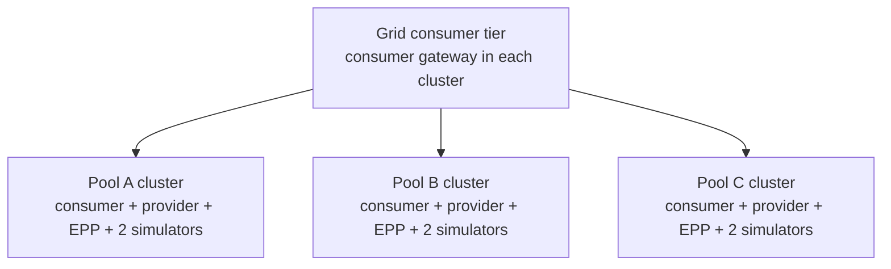

# Weighted Multi-Cluster Routing

**A live view of expected preference and measured provider selection**

> As a platform engineer, I want to see how independent inference-pool load
> changes Grid's routing preference without guessing from logs.

---

# How Grid makes a routing decision

Health, trust, capability, freshness, admission, locality, and session affinity
retain precedence. Only eligible, new, unbound requests enter weighted selection.

---

# Static capacity and dynamic pressure

| Static capacity | Dynamic adjustment |
|---|---|
| Configured provider capacity | EPP-reported simulator metric |
| `100 / 100 / 100` baseline | Normalized available capacity |
| Equal expected shares at idle | New effective overlay weights |
| Operator intent | Runtime preference |

The simulator reports deterministic queue depth through EPP. The routing sampler
measures requests; it does not create pressure.

---

# Three-cluster demo topology

Each consumer receives converged routing state and may select an eligible
provider gateway in any pool. A recording may use one ingress endpoint without
claiming that every ingress path was exercised.

---

# What the demo proves

**Static:** equal capacity and equal pressure produce equal expected shares,
with normal statistical variation in measured samples.

**Dynamic:** changing one reported metric changes effective weights, publishes a
new overlay, converges through Grid and Praxis, and shifts measured provider
selection after a fresh measurement window.

---

# Weighted routing demonstrated

- Three independent clusters and three provider pools
- One logical consumer tier with converged edge state
- EPP metrics changing Grid's effective preference
- Atomic Praxis serving revisions
- Measured provider selection compared with overlay expectation
- No request-path control-plane lookup required
